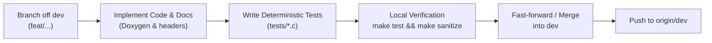

# Git Flow & Testing Guidelines

This document outlines the branching model, testing iteration cycle, and commit discipline for the `alps-trackstick-daemon` project.

---

## 1. Branch Topology

```text
master (v0.5.0) ───[Release v0.6.0]────────────────────────────> (Production / Stable Releases)
   │                       ▲
   └──> dev ───────────────┴───[PR/Merge]───────────────────────> (Integration / Active Development)
         │                       ▲
         └──> feat/nonblocking ──┘ (Topic / Feature Iterations)
```

### Branches
* **`master`**:
  - Always deployable, stable release branch.
  - Contains only annotated version tags (`v0.5.0`, `v0.6.0`, etc.).
  - Direct commits to `master` are prohibited. Merges into `master` happen from `dev` once milestones pass full test verification.
* **`dev`**:
  - Primary integration branch where active development takes place.
  - All feature branches branch off `dev` and merge back into `dev`.
* **`feat/<feature-name>` / `fix/<bug-name>`**:
  - Short-lived topic branches for individual iterations or bug fixes.
  - Branch from: `dev`
  - Merge back into: `dev`

---

## 2. Standard Iteration & Testing Cycle

Every feature or bugfix iteration must strictly follow this cycle before merging into `dev`:



1. **Create Branch**:
   ```bash
   git checkout dev
   git pull origin dev
   git checkout -b feat/<iteration-name>
   ```

2. **Implement with Documentation**:
   - Every public function and header must have complete Doxygen comments explaining its physical rationale and interface contracts.
   - Maintain zero vendor/model leaks in comments and code.

3. **Write Unit Tests First / Alongside**:
   - Add deterministic unit test cases in `tests/` covering both happy paths and edge cases (e.g., saturation, timeouts, cancellation, race conditions).

4. **Verify Locally**:
   ```bash
   make clean
   make
   make test
   make sanitize   # ASan + UBSan memory/undefined behavior validation
   ```

5. **Merge to `dev`**:
   ```bash
   git checkout dev
   git merge feat/<iteration-name>
   git push origin dev
   ```

6. **Release to `master` (Milestone completion)**:
   - When a versioned milestone is reached:
   ```bash
   git checkout master
   git merge dev
   git tag -a v0.X.Y -m "v0.X.Y: Release summary"
   git push origin master --tags
   git checkout dev
   ```

---

## 3. Commit Discipline

* Use concise, imperative commit messages:
  - `feat: implement non-blocking click hold timer`
  - `test: add unit tests for high-resolution wheel accumulator`
  - `refactor: extract timeout calculation into dedicated helper`
  - `docs: update roadmap and git flow guidelines`
* Keep commits atomic and self-contained (compiles and passes tests at each commit).
