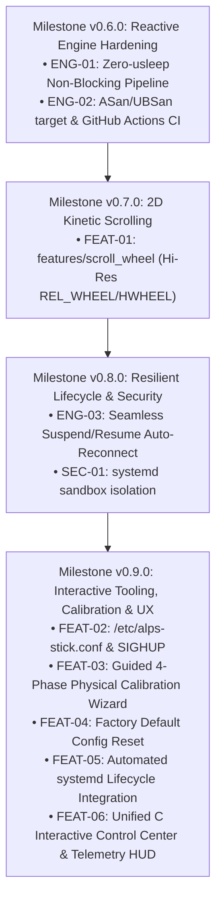

# Engineering Roadmap & Prioritization Matrix

This document tracks future architectural enhancements, feature requests, and the rational prioritization matrix for the `alps-trackstick-daemon` project.

---

## 1. Candidate Initiatives

| ID | Initiative | Description | Value Proposition |
| :--- | :--- | :--- | :--- |
| **ENG-01** | **100% Non-Blocking Engine (Zero-`usleep`)** | Move the 15ms discrete click hold and button-up delay from `usleep()` in `emitter.c` into a timed state transition in `tap_gesture` evaluated by `epoll_wait`. | **Zero event loop stall**. Prevents kernel input event buffering or micro-jitter during rapid navigation while clicking. |
| **ENG-02** | **Sanitizers & Automated CI** | Add `make sanitize` (`-fsanitize=address,undefined`) and a GitHub Actions workflow running on pushes/PRs to `dev` and `master`. | **Continuous reliability**. Guarantees zero memory leaks, buffer overflows, or undefined behavior across compiler toolchains. |
| **FEAT-01** | **High-Res 2D Trackstick Scrolling (`features/scroll_wheel`)** | Implement continuous vertical and horizontal scrolling (`REL_WHEEL_HI_RES`, `REL_HWHEEL_HI_RES`) triggered by middle-button hold or deep Z-pressure. | **Major ergonomics leap**. Adds smooth scrolling without touching the touchpad or keyboard. |
| **ENG-03** | **Instant Suspend/Resume Auto-Reconnect** | Catch `EPOLLHUP` and poll `/dev/input` internally with backoff without destroying the virtual `uinput` node or terminating the daemon process. | **Seamless laptop wake**. Eliminates reliance on `systemd` process restart on suspend/resume. |
| **FEAT-02** | **Declarative Config (`/etc/alps-stick.conf`) & `SIGHUP`** | Implement simple INI/key-value parser for configuration file, plus hot-reload on `SIGHUP` (`systemctl reload`). | **Ease of administration**. Allows tuning thresholds without editing systemd unit files. |
| **FEAT-03** | **Interactive Calibration Wizard (`--calibrate`)** | Terminal wizard guiding user through 5 sample taps, measuring peak Z, duration, and shear to generate personalized thresholds. | **Tailored ergonomics**. Accommodates individual hardware variances and fingertip pressure styles. |
| **SEC-01** | **`systemd` Security Hardening & Least-Privilege udev** | Restrict daemon service with strict systemd namespaces (`ProtectSystem`, `ProtectHome`, `NoNewPrivileges`, `PrivateNetwork`). | **Defense-in-depth**. Eliminates privilege risk for a daemon running with root/input capabilities. |

---

## 2. Rational Prioritization Matrix

We score initiatives across four criteria (1 to 5 scale):
* **Architectural Prerequisite (AP)**: Does other work depend on this being done first?
* **Runtime Impact (RI)**: Does this improve core latency, responsiveness, or stability?
* **Implementation Feasibility (IF)**: Can it be implemented cleanly with low regression risk?
* **User Value (UV)**: How noticeable and useful is this to everyday trackstick users?

$$\text{Score} = (\text{AP} \times 3) + (\text{RI} \times 2) + (\text{UV} \times 2) + \text{IF}$$

| Rank | ID | Initiative | AP (1-5) | RI (1-5) | UV (1-5) | IF (1-5) | Total Score | Target Milestone |
| :---: | :--- | :--- | :---: | :---: | :---: | :---: | :---: | :---: |
| **1** | **ENG-01** | **Non-Blocking Engine (Zero-`usleep`)** | 5 | 5 | 4 | 5 | **38** | `v0.6.0` (Complete) |
| **2** | **ENG-02** | **Sanitizers & GitHub Actions CI** | 4 | 4 | 3 | 5 | **31** | `v0.6.0` (Complete) |
| **3** | **FEAT-01** | **High-Res 2D Trackstick Scrolling** | 2 | 4 | 5 | 3 | **27** | `v0.7.0` (Complete) |
| **4** | **ENG-03** | **Instant Suspend/Resume Auto-Reconnect** | 2 | 4 | 4 | 4 | **26** | `v0.8.0` (Complete) |
| **5** | **SEC-01** | **`systemd` Security Sandboxing** | 1 | 3 | 3 | 5 | **20** | `v0.8.0` (Complete) |
| **6** | **FEAT-02** | **Config File & `SIGHUP` Live Reload** | 1 | 2 | 4 | 4 | **19** | `v0.9.0` (Complete) |
| **7** | **FEAT-03** | **Interactive Calibration Wizard** | 1 | 2 | 4 | 3 | **18** | `v0.9.0` (Complete) |
| **8** | **FEAT-04** | **Factory Default Config Reset** | 1 | 2 | 4 | 5 | **18** | `v0.9.0` (Complete) |
| **9** | **FEAT-05** | **Automated `systemd` Lifecycle Integration** | 1 | 3 | 4 | 5 | **20** | `v0.9.0` (Complete) |
| **10** | **FEAT-06** | **Unified C Interactive Control Center & UX** | 1 | 3 | 5 | 4 | **22** | `v0.9.0` (Complete) |

---

## 3. Prioritization Rationale & Dependency Sequence

### Why Focus on ENG-01 (Non-Blocking Engine) First?
1. **Architectural Purity**: The hallmark of our `v0.5.0` refactor is decoupling pure state logic from I/O. However, `usleep(15ms)` in `alps_emitter_dispatch()` violates this: while sleeping, the thread blocks, unable to service `epoll` or capture high-velocity steering.
2. **Foundational for Scrolling (FEAT-01)**: When 2D scrolling is introduced, continuous sub-pixel motion streams will flow while buttons or taps occur. Any blocking sleep in the emitter would create noticeable stutter in scroll frames.
3. **Deterministic Testing**: Converting the hold delay into a pure state transition allows unit tests to assert the exact millisecond `BUTTON_UP` is emitted without calling `sleep()` or slowing down `make test`.

### Why Pair with ENG-02 (Sanitizers & CI)?
Having `make sanitize` (`-fsanitize=address,undefined`) and a GitHub Actions workflow ensures that every PR and push on `dev` is certified bug-free before merging to `master`.

---

## 4. Phased Milestones

